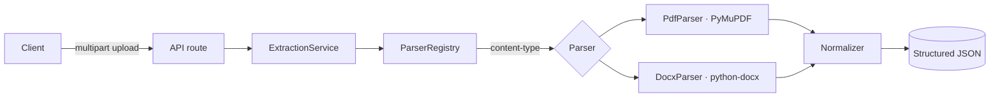

# document-extraction-api

Turn **PDF** and **DOCX** files into structured JSON — sections, entities
(emails, URLs, phone numbers, dates), and document metadata — through a small,
strongly-typed, well-tested FastAPI service.

[](https://github.com/VarunGandhi12/document-extraction-api/actions/workflows/ci.yml)


> A focused, production-shaped service that shows how I structure a backend:
> clean layering, dependency injection, typed contracts, real tests, and a
> container that runs anywhere.

---

## Why this exists

Extracting text from documents is easy to do badly — a single 300-line function
that mixes file I/O, parsing, and business rules. This repo does it the way I'd
do it on a team: **each concern in its own layer, each layer independently
testable, and a new file type is a new class rather than an edit to everything.**

## Features

- 📄 **PDF + DOCX** parsing behind one uniform API
- 🧩 **Structured output** — metadata, headed sections, and typed entities with confidence scores
- 🧱 **Strategy pattern** — add a file type by writing one `Parser` + one registry line
- 🛡️ **Typed & validated** end-to-end (Pydantic v2, `mypy --strict`)
- 🧪 **Unit + integration tests** with an **85% coverage gate** in CI
- 🐳 **Multi-stage Docker** image, non-root, with a healthcheck
- 📈 **Structured JSON logs**, no PII
- 📚 **Auto-generated OpenAPI / Swagger** at `/docs`

## Quickstart

```bash
# with Docker
docker compose up --build
# → http://localhost:8000/docs

# or locally
python -m venv .venv && source .venv/bin/activate
pip install -e ".[dev]"
uvicorn app.main:app --reload
```

## API

### `POST /v1/extract`

```bash
curl -s -X POST http://localhost:8000/v1/extract \
  -F "file=@resume.pdf;type=application/pdf" | jq
```

```jsonc
{
  "metadata": {
    "filename": "resume.pdf",
    "content_type": "application/pdf",
    "page_count": 1,
    "word_count": 142,
    "char_count": 921
  },
  "sections": [
    { "heading": "Experience", "content": "Built and shipped …", "word_count": 58 }
  ],
  "entities": [
    { "type": "email", "value": "jane.doe@example.com", "confidence": 0.99 },
    { "type": "url",   "value": "https://example.com",   "confidence": 0.95 },
    { "type": "phone", "value": "+1 415 555 0132",        "confidence": 0.8  },
    { "type": "date",  "value": "2026-01-15",             "confidence": 0.7  }
  ],
  "text_excerpt": "Jane Doe …"
}
```

| Status | Meaning |
|---|---|
| `200` | Extracted successfully |
| `413` | File exceeds the configured size limit |
| `415` | Unsupported content type |
| `422` | File matched a known type but could not be parsed |

### `GET /health`
Liveness/readiness probe — returns `{"status": "ok", "version": "..."}`.

## Architecture



The API layer never imports a parser and the parsers never import FastAPI. The
service depends on the `Parser` **protocol**, so the whole pipeline is swappable
in tests via `app.dependency_overrides`.

### Project layout

```
app/
├── api/          # HTTP routes + dependency wiring (thin)
├── core/         # config, logging, domain errors
├── parsers/      # Parser protocol + PDF/DOCX strategies + registry
├── schemas/      # Pydantic request/response contracts
├── services/     # ExtractionService (orchestration) + normalizer (pure logic)
└── main.py       # app factory + error→HTTP mapping
tests/
├── unit/         # normalizer + registry (pure, fast)
└── integration/  # real HTTP through FastAPI with generated fixtures
```

## Testing

```bash
pytest                 # runs unit + integration, prints coverage, fails < 85%
```

Sample PDFs/DOCX are **generated in-process** (see `tests/conftest.py`), so the
repo ships no binary fixtures and the fixtures can never drift from the asserts.

## Design notes

- **Errors are domain objects** (`app/core/errors.py`), mapped to HTTP in one
  place — parsers and services stay transport-agnostic.
- **Confidence scores are transparent heuristics**, not a hidden model: precise
  patterns (email/URL) score higher than fuzzy ones (phone). Easy to reason about
  and to threshold on.
- **Files are parsed in memory** and never touch disk.

## Roadmap

- [ ] `.txt` and `.md` parsers (trivial with the strategy pattern)
- [ ] Language detection on extracted text
- [ ] Optional OCR fallback for image-only PDFs
- [ ] Latency/throughput benchmark published in CI

## License

[MIT](./LICENSE)
